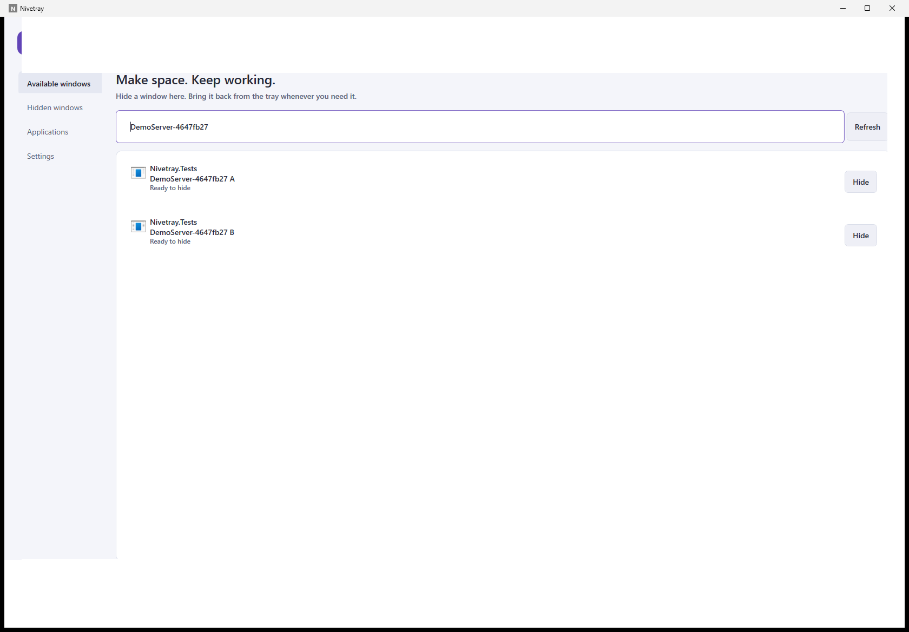
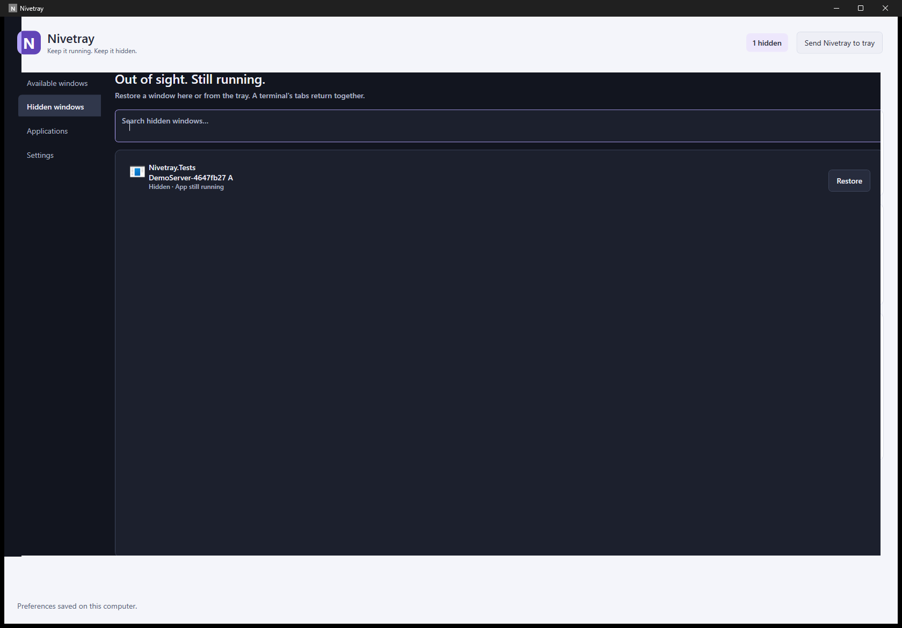

# Nivetray

**Keep it running. Keep it hidden.**

Nivetray hides application windows in the Windows notification area without closing, suspending or terminating their processes. Clear your taskbar while a server, terminal session or desktop app keeps working.

## A calmer workspace

- Find real application windows by title, app name or executable path. Hide one window with its **Hide** button.
- Restore windows individually, restore all, or search the full hidden-window list. Recovery states stay visible when Windows cannot confirm an operation.
- Use a recognizable tray icon: double-click to reopen Nivetray; right-click for the eight most recently hidden windows, **View all / Search**, settings and safe exit.
- Favorite an app, exclude it, or explicitly include compatible helper windows. Nothing hides automatically.
- Choose light, dark or system theme. Windows high contrast overrides the palette. Keyboard shortcuts and accessible action names are built in.
- Preferences stay in local JSON. No accounts, credentials, telemetry, network connections, injected code or normal-use administrator requirement.





These are real screenshots of isolated test windows, not mockups or personal apps.

## Get started

Download a portable ZIP from an approved release, or download the `Nivetray-win-x64` / `Nivetray-win-arm64` artifact from [GitHub Actions](https://github.com/maxgab201/Nivetray/actions). Workflow artifacts contain a ZIP and a SHA-256 file; unpack the complete application ZIP and run `Nivetray.exe`. The self-contained package includes .NET and needs no installer. Builds are unsigned. Version 0.2.0 is currently unreleased; successful CI does not constitute release approval.

1. Open Nivetray and find your application under **Available windows**. Use the search field or **Refresh**.
2. Choose **Hide** next to its window. The application stays running.
3. Open **Hidden windows**, or the Nivetray tray menu, to restore it.
4. Choose **Restore all and exit** to quit safely. Closing the panel keeps Nivetray in the tray by default; this is configurable. Minimize uses the taskbar, while **Send Nivetray to tray** hides only this panel.

**Ctrl+F** focuses the current search field; **F5** refreshes windows; **Escape** sends the panel to the tray. Opening Nivetray again reopens its existing instance. Normal exit queues behind a pending hide and restores managed windows before shutting down.

## Applications and rules

- **Favorite** is an independent checkbox that moves an executable near the top. It can be combined with a helper-window rule; it never hides or launches an app.
- **Show standard windows** keeps normal filtering for that app (the default).
- **Include helper windows** (legacy `Include`) allows its compatible visible, titled owned/tool windows.
- **Exclude from list** (legacy `Exclude`) removes that executable from detection; it wins over the global helper-window preference.

Use **Applications** to search, add, browse for an executable, or remove a rule. Settings can show helper windows globally, but system surfaces, invisible/cloaked/untitled windows, Nivetray itself and uncertain identities remain protected. A favorite is separate from an advanced helper-window exception; neither authorizes future automatic behavior.

Terminal windows belong to their host, such as `conhost.exe`, `OpenConsole.exe` or `WindowsTerminal.exe`, which can differ from the server or shell inside. Nivetray manages the whole window, including all of its tabs. It is not a terminal emulator or process manager. File Explorer windows are eligible; desktop/taskbar surfaces are excluded.

## Recovery and limits

Nivetray checks HWND, PID, process start time, owning thread, class and an independent lifetime stamp. Lost authorization is **not** treated as successful restoration: a live entry remains tracked, and authorization can be reacquired only when the original lifetime is verified. An unavailable identity is retained without touching a window. Only confirmed destruction or replacement removes an obsolete entry.

If recovery needs attention, keep Nivetray running and retry **Restore**. Let an unresponsive app recover, dismiss its permission prompt if present, or use its own Show/Open command when available. **Copy recovery details** provides IDs and categorical errors without titles or paths. Exiting is cancelled while recovery remains unresolved; the panel and tray stay available. See [safety details](docs/safety.md).

There is no crash watchdog. Forced termination, power loss or Windows shutdown cannot guarantee restoration. Live HWNDs are never saved for reuse in another session. Win32 cannot make identity validation and a foreign-window operation atomic, and asynchronous requests can complete late. Same-user malicious interference is outside this accidental-reuse protection. Some apps change their own behavior when hidden; Nivetray cannot override that.

The fourth title-bar button is **not implemented**. The [overlay feasibility design](docs/overlay-design.md) remains a separate, disabled future phase.

## Compatibility and privacy

Target: Windows 10/11, x64 and ARM64. Actual local validation: **Windows 11 x64**, WinForms fixtures and WPF UI moved between the available 96/144-DPI monitors in per-monitor awareness mode, including normal/minimized/maximized windows and a continuing TCP server. The dedicated console test reports SKIP on this desktop's invisible/pseudoconsole host. CMD, Windows PowerShell, PowerShell 7, Windows Terminal, OpenConsole, Windows 10 and physical ARM64 execution need dedicated compatibility runs. Cross-publishing ARM64 is not execution testing. See [verification](docs/verification.md) and Microsoft's [.NET OS support policy](https://github.com/dotnet/core/blob/main/release-notes/10.0/supported-os.md).

Default data folder: `%LOCALAPPDATA%\Nivetray`. `settings.json` stores theme, behavior and executable rules, not titles or live HWNDs. Existing preferences migrate to schema 3 without changing rule effects: legacy Manage becomes Standard plus IsFavorite, while Include and Exclude retain their visibility behavior. A malformed original is backed up before a later explicit save. `diagnostics.log` uses categorical errors, deduplicates repeats for one minute and rotates with one 256 KiB backup. Nothing is transmitted. Custom profiles are supported with `Nivetray.exe --data-directory "C:\MyData\Nivetray"`; GUI tests use an isolated profile under ignored artifacts. Startup with Windows is not implemented.

## Build, test and package

Install the [.NET 10 SDK](https://dotnet.microsoft.com/download/dotnet/10.0) on Windows. Visual Studio's .NET desktop workload is optional.

```powershell
git clone https://github.com/maxgab201/Nivetray.git
cd Nivetray
dotnet build Nivetray.sln -c Release
dotnet run --project src/Nivetray.App -c Release
dotnet run --project tests/Nivetray.Tests -c Release
powershell -NoProfile -ExecutionPolicy Bypass -File scripts/BuildPortable.ps1 -Runtime win-x64
```

Use `win-arm64` to cross-publish ARM64. The packaging script verifies expected files and SHA-256. CI runs Release builds and deterministic tests, then uploads both architectures. Public releases are never automatic: an explicitly requested workflow can prepare a draft for an existing version tag. See the [testing guide](docs/testing.md) for interactive Win32 / UI Automation commands and release gates. `dotnet test` is not this repository's test runner.

## Architecture and performance

```text
src/Nivetray.Core       Identity/recovery lifecycle, filtering/search, tray policy, JSON
src/Nivetray.Windows    Limited-rights Win32 discovery and bounded visibility operations
src/Nivetray.App        WPF workspace, theme/icon/log services, tray and app lifecycle
tests/                 Deterministic regressions, isolated native fixtures, UI Automation
scripts/               Verified portable packaging
docs/                  Audit, safety, QA, screenshots and overlay feasibility
```

No production NuGet dependencies. Detection and icon IO run off the dispatcher; refresh requests coalesce without permanent polling. Frozen icons are bounded to 64 executables, with one outstanding loader, a 250 ms caller wait and shutdown cancellation. No cache lock spans shell IO. Tray items are bounded and disposed. This static WPF utility uses software rendering: local comparative measurements substantially reduced private memory while keeping sampled idle CPU at 0%. Short refresh samples stabilized; they do not certify days-long leak freedom. Detailed before/after measurements and remaining tests are in [verification](docs/verification.md).

## Contribute and license

Read [CONTRIBUTING](CONTRIBUTING.md), [security notes](SECURITY.md) and the [changelog](CHANGELOG.md). Compatibility reports should contain sanitized reproduction steps, not personal titles or screenshots.

[MIT](LICENSE) — Copyright (c) 2026 maxgab201 and Nivetray contributors.
